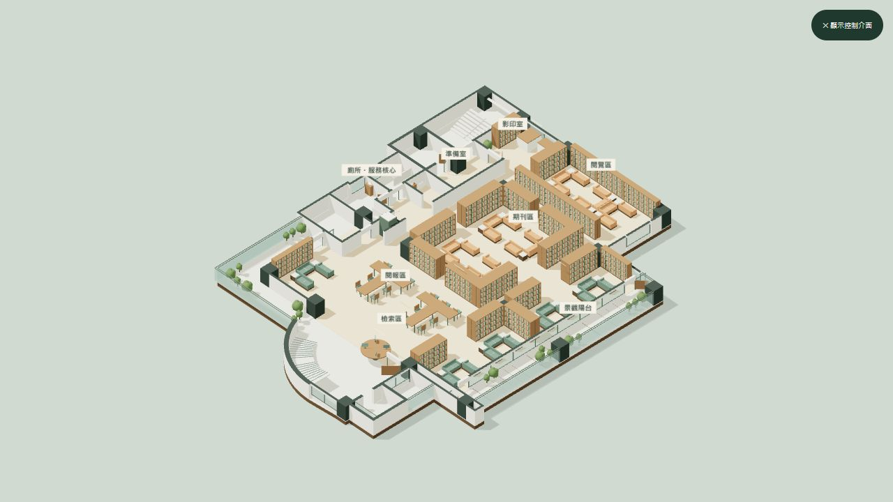
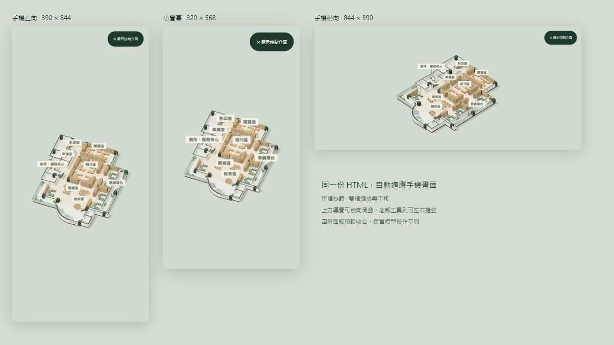

# 圖書館互動 3D 空間展示

以圖書館平面圖建立的繁體中文互動網頁，適合手機與電腦檢視。

## 功能

- 單檔 HTML，內嵌模型、平面圖及程式資源。
- 開啟時預設純淨模型，可隨時顯示控制介面。
- 電腦滾輪、手機雙指與縮放按鈕均無預設倍率上限。
- 44 筆原圖尺寸標註，可放大核對與定位。
- 預設字級 10px，可選 10／12／14px，手機單指旋轉、雙指縮放與平移。
- 圖層顯示、半透明、五階段空間演化及材質切換。
- 自動環繞 ON／OFF、View 方向控制、主視圖及平行／透視投影。
- 獨立環境背景色、自訂選色與日夜燈光。

開啟 `index.html` 即可使用。GitHub Pages 設定為從 `main` 分支的根目錄發布。

## 圖面說明

平面位置與尺寸依來源圖面建立；牆高、材質及室內表現屬展示設定。此網頁供空間檢視使用。

程式內嵌 Three.js 及 GSAP，第三方程式的授權資訊保留於原始碼中。
